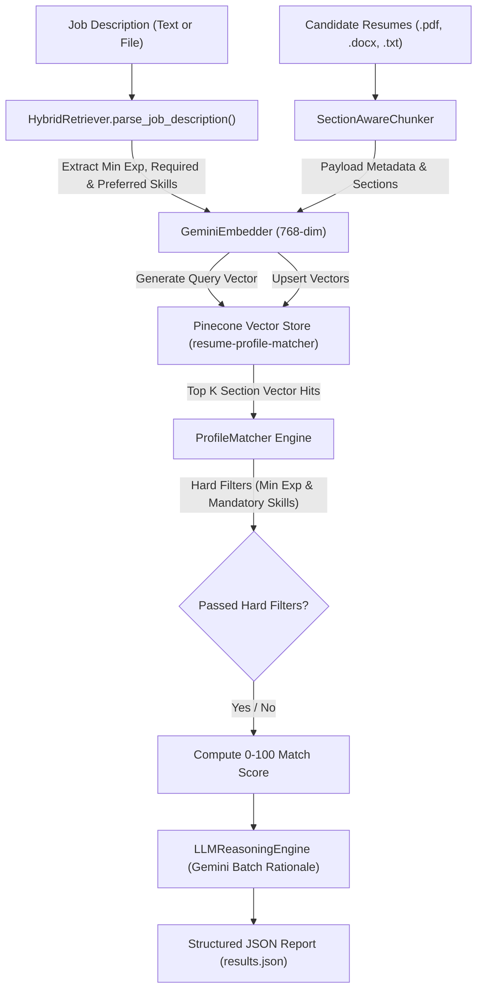

# RAG-Based Resume Profile Matching System

A production-grade **Retrieval-Augmented Generation (RAG)** Candidate Profile Matching Application built in Python. The system evaluates multi-format candidate resumes (`.pdf`, `.docx`, `.txt`) against Job Descriptions (JDs) by combining **Pinecone Serverless Vector Search**, **Google Gemini 768-dimensional Matryoshka Embeddings**, **Section-Aware Chunking**, **Hard Constraint Filtering**, **0–100 Quantitative Scoring**, and **Gemini LLM Match Rationale Generation**.

---

## 🌟 Key Features

- **Multi-Format Parsing**: Extracts text cleanly from PDF (`pypdf`), Word DOCX (`python-docx`), and plain text (`.txt`) resumes.
- **Section-Aware Chunking**: Intelligently parses resume structural sections (`Professional Summary`, `Work Experience`, `Technical Skills`, `Education`, `Projects`), calculates total candidate experience years, extracts canonical skill casing, and applies a 512-token sliding window.
- **768-Dim Dense Vector Search**: Integrates Pinecone serverless vector storage with Google Gemini `gemini-embedding-001` configured to 768 dimensions using Cosine Similarity metrics.
- **Rate Limit & Free-Tier Optimization**:
  - **Persistent Local SHA-256 Vector Cache**: Writes embeddings to `.embedding_cache.json`, preventing redundant API calls.
  - **Multi-Item API Batching**: Embeds up to 20 text chunks per API call (`contents=[text1, text2, ...]`), reducing daily API requests (RPD) by 95%.
- **Hard Constraint Filtering**: Enforces strict candidate qualification checks (e.g., minimum experience years threshold & mandatory required skill checks) before scoring.
- **0–100 Quantitative Match Scoring**: Computes a transparent, 4-part weighted relevance score:
  - **Semantic Vector Similarity** (40%)
  - **Required Must-Have Skills Match** (35%)
  - **Experience Years Ratio** (15%)
  - **Preferred / Nice-to-Have Skills Match** (10%)
- **Single-Batch LLM Match Reasoning**: Generates candidate evaluation summaries via Gemini in 1 single batch call to maximize throughput and minimize latency.
- **Automated Benchmark & Evaluation Suite**: Includes scripts to benchmark multi-JD system accuracy across 50 candidate resumes and 10 diverse job descriptions.

---

## 🏗 System Architecture



---

## 📁 Repository Directory Structure

```text
RAG-Based-Profile-Matching/
│
├── profile_matcher.py          # Main CLI Application & Entry Point
├── requirements.txt            # Python Dependencies
├── .env.example                # Environment Variable Template
├── README.md                   # Project Documentation
│
├── src/                        # Core Implementation Modules
│   ├── chunker.py              # SectionAwareChunker & Skill Extraction
│   ├── fs_tools.py             # PDF, DOCX, TXT Multi-format Reader
│   ├── init_pinecone.py        # Pinecone Serverless Index Initializer
│   ├── vector_store.py         # GeminiEmbedder & PineconeVectorStore
│   ├── retriever.py            # HybridRetriever & Keyword Density Engine
│   ├── matcher.py              # ProfileMatcher Hard Filter & 0-100 Scoring
│   ├── llm_reasoning.py        # Gemini Single-Batch LLM Rationale Engine
│   └── logger.py               # Structured Session Logging Utility
│
├── scripts/                    # Utility & Benchmark Scripts
│   ├── create_sample_resumes.py# Generates 50 Sample Resumes (.pdf, .docx, .txt)
│   ├── create_sample_jds.py    # Generates 10 Diverse Sample Job Descriptions
│   ├── ingest_resumes.py       # Batch Resumes Vector Indexer
│   └── benchmark_matching.py   # System Performance & Accuracy Benchmark
│
├── tests/                      # Automated Test Suite
│   ├── conftest.py             # PyTest Path Configuration
│   └── test_suite.py           # Consolidated Unit & Integration Tests (31 Cases)
│
├── job_descriptions/           # Sample Job Description Files (10 JDs)
└── resumes/                    # Sample Candidate Resumes Pool (50 Resumes)
```

---

## ⚙️ Prerequisites & Environment Setup

### 1. Python Environment Setup
Python **3.10+** is recommended.

```bash
# Clone the repository
git clone https://github.com/your-username/RAG-Based-Profile-Matching.git
cd RAG-Based-Profile-Matching

# Create and activate a virtual environment
python -m venv venv

# On Windows (PowerShell):
.\venv\Scripts\Activate.ps1

# On Linux/macOS:
source venv/bin/activate
```

### 2. Install Dependencies
```bash
pip install -r requirements.txt
```

### 3. Environment Variables (`.env`)
Create a `.env` file in the project root directory by copying `.env.example`:

```bash
cp .env.example .env
```

Fill in your API keys in `.env`:
```env
GEMINI_API_KEY=your_google_gemini_api_key_here
PINECONE_API_KEY=your_pinecone_api_key_here
PINECONE_INDEX_NAME=resume-profile-matcher
```

---

## 🚀 How to Run

### Step 1: Generate Sample Data (50 Resumes & 10 JDs)
Generate 50 realistic candidate resumes (across PDF, DOCX, and TXT formats) and 10 diverse job descriptions:

```bash
# Generate 50 candidate resumes in ./resumes/
python scripts/create_sample_resumes.py

# Generate 10 job descriptions in ./job_descriptions/
python scripts/create_sample_jds.py
```

### Step 2: Index Resumes into Pinecone Vector Database
Parse, chunk, embed, and index all candidate resumes into Pinecone:

```bash
python scripts/ingest_resumes.py
```

### Step 3: Run Profile Matching CLI

#### Option A: Match using a Job Description file
```bash
python profile_matcher.py --jd_file job_descriptions/jd_01_senior_ai_systems_engineer.txt --top_k 5 --output results.json
```

#### Option B: Match using inline Job Description text
```bash
python profile_matcher.py --jd "Job Title: Senior Data Engineer. Minimum 5 years experience. Required Skills: PySpark, Snowflake, Airflow, SQL." --top_k 5
```

#### Option C: Run with default prompt
```bash
python profile_matcher.py
```

---

## 📊 Performance Benchmarks & Accuracy Testing

### Run Multi-JD System Benchmark Evaluation
Evaluates all 10 Job Descriptions in `job_descriptions/` against the 50 candidate vector database:

```bash
python scripts/benchmark_matching.py
```

- **Candidate Pool**: 50 Resumes (245 vector chunks indexed in Pinecone)
- **Tested JDs**: 10 Diverse Engineering Domains
- **Average Match Latency**: **~1.32 seconds** per JD
- **Output Report**: Saved to `scratch/benchmark_results.json`

---

## 🧪 Running Automated Tests

Run the consolidated unit and integration test suite (31 test cases):

```bash
python -m pytest tests/
```

---

## 📑 Output JSON Schema (`results.json`)

```json
{
  "job_description_summary": {
    "title": "Senior AI & LLM Systems Engineer",
    "min_experience_years": 5.0,
    "required_skills": [
      "Docker",
      "FastAPI",
      "LangChain",
      "Pinecone",
      "PyTorch",
      "Python"
    ],
    "preferred_skills": [
      "AWS",
      "ChromaDB",
      "Kubernetes"
    ]
  },
  "total_candidates_evaluated": 14,
  "candidates_passed_filters": 1,
  "candidates_failed_filters": 13,
  "top_matches": [
    {
      "rank": 1,
      "candidate_name": "John Doe",
      "resume_path": "resumes\\resume_john_doe.pdf",
      "match_score": 92,
      "passed_mandatory_filters": true,
      "matched_skills": {
        "must_have": [
          "Docker",
          "FastAPI",
          "LangChain",
          "Pinecone",
          "PyTorch",
          "Python"
        ],
        "preferred": [
          "AWS",
          "ChromaDB",
          "Kubernetes"
        ]
      },
      "missing_skills": [],
      "relevant_excerpts": [
        "Senior AI Engineer with 7+ years of experience building scalable backend microservices, autonomous LLM agents..."
      ],
      "match_reasoning": "John Doe is an ideal candidate who exceeds the 5-year experience requirement (7 years) and demonstrates complete mastery across all required skills..."
    }
  ]
}
```

---

## 📜 License
Distributed under the MIT License.